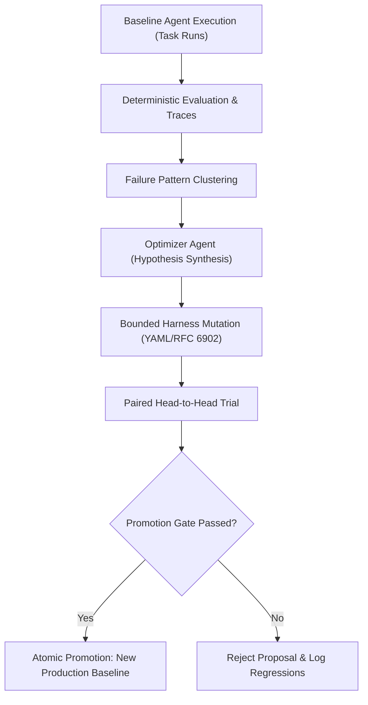

# Autonomous Self-Improvement in Production DataOps Agents: A Systems Study

**Charan Sri Teja**  
*HarnessLab Technical Brief*

---

## 1. The Core Thesis: Self-Improvement Without Catastrophic Drift

Most conversational AI assistants are static: once deployed, they repeat the same operational mistakes until a human engineer reads the logs, rewrites the prompts, or adds a patch. But when agents handle complex enterprise DataOps—navigating dynamic PostgreSQL schemas, calculating metric aggregations, and answering business stakeholders—human-in-the-loop tuning becomes an expensive bottleneck.

The naive alternative—giving an LLM unconstrained power to modify its own code or prompts—usually ends in catastrophic failure: hallucinated tools, runaway token consumption, or subtle safety regressions.

**HarnessLab** explores a grounded middle path: **can an agent systematically diagnose its own execution failures and optimize its operational configuration through empirical, paired validation?**

Rather than rewriting executable code, the agent modifies its **Harness**—the deterministic behavioral envelope governing how it discovers schemas, retries database errors, verifies numeric answers, and manages token budgets. Through a closed-loop cycle of *observation $\to$ diagnosis $\to$ hypothesis $\to$ validation $\to$ promotion*, the system proves that an agent can autonomously improve its accuracy and cost efficiency against real databases.



---

## 2. Anatomy of the Self-Improvement Loop

The HarnessLab self-improvement cycle runs entirely under software and database fences. It does not rely on subjective LLM scoring; it measures empirical outcomes on a calibrated 120-task benchmark against PostgreSQL sandbox instances.

### Step 1: Immutable Trace Recording
Every single action the worker agent makes is captured in sequential, append-only database traces:
- Model token usage (input/output tokens and latency)
- Tool requests (e.g., AST-validated read-only SQL, `describe_schema`, `list_tables`)
- Database responses (table metadata, retrieved row vectors, or synthetic timeout faults)
- Final structured business answers with evidence citations

### Step 2: Automated Failure Clustering
When runs fail—whether from PostgreSQL syntax errors, calculation mismatches, or token budget exhaustion—the evaluator analyzes the entire execution graph. Instead of passing noisy raw text to the optimizer, it groups failures into concrete behavioral clusters:
- `schema_before_discovery`: The agent attempted SQL queries before discovering available tables, burning model turns in avoidable error loops.
- `turn_budget_exhaustion`: The agent got stuck analyzing schema relations and ran out of turns before formulating an answer.
- `unverified_numeric_claim`: Calculations returned numbers without citing the underlying row evidence.

### Step 3: Bounded Hypothesis Generation
The Optimizer agent (running on Claude Sonnet 4.5) inspects the clustered failure diagnostics and the immutable baseline configuration. It cannot write arbitrary Python code or touch database credentials. It can only emit structured RFC 6902 JSON patch operations targeting a strictly typed set of operational knobs:

```yaml
# Target Harness Knobs Open to Self-Improvement
/prompt/task_guidance           # Focused behavioral steering (max 600 chars)
/workflow/schema_inspection     # 'on_error' vs. 'before_first_sql'
/workflow/verify_numeric_answers# Require explicit calculation verification
/workflow/retry_policy          # 'none' vs. 'error_aware'
/context/recent_tool_results    # Sliding window depth (2-8 entries)
/limits/max_tool_calls          # Global tool call ceiling (4-12)
/limits/max_retries_per_tool    # Recovery attempts per tool (0-2)
```

For instance, when observing that baseline runs were exhausting token budgets on complex joins, the optimizer generated a patch switching `/workflow/schema_inspection` from reactive `on_error` to proactive `before_first_sql`.

### Step 4: Paired Counterfactual Testing
A proposed improvement is never trusted on faith. The dispatcher orchestrates a paired trial:
- **Arm 01 (Baseline)** and **Arm 02 (Candidate)** are run against the exact same seed scenarios and synthetic data slices.
- The deterministic evaluator grades both arms on answer correctness, evidence validity, latency, and token cost.

### Step 5: Gated Promotion
If and only if the candidate beats or matches the baseline on accuracy, achieves equal or lower cost, and causes zero safety violations, an authorized database transaction advances the active production channel pointer to the new harness SHA-256 hash. The candidate becomes the next baseline.

---

## 3. Real System Observations: The UI in Action

To verify that self-improvement is taking place, the system provides live visualization of the agent's internal state, queries, and comparative outputs.

### Observing Active Trials & Channels
The platform monitors multiple experiments simultaneously, tracking baseline hash lineage, active execution stages, and exact token spend:


> **Observation**: The dashboard tracks every experiment from diagnosis to final report. In our live AWS Bedrock trials, all 42 task runs completed across all 5 stages within an aggregate budget of **\$1.31**, showing that empirical self-improvement does not require thousands of dollars in compute.

---

### Linear Stage Progress & Arm Allocation
Every trial proceeds through transparent checkpoints: `Diagnose` $\to$ `Propose` $\to$ `Screen` $\to$ `Validate` $\to$ `Report`:


> **Observation**: The system displays arm allocation (Baseline vs. Candidate) under identical seed conditions, ensuring that any measured gain is attributable to harness policy changes rather than benchmark variance.

---

### Live Query Outputs & Direct Output Comparison
The primary view of the trial comparison does not hide behind raw JSON. It displays the live queries, retrieved PostgreSQL tables, and head-to-head output metrics:


> **Key Observations in the Live Execution**:
> 1. **Extracted Business Answer**: The primary card highlights the verified metric (`order_count = 6`) extracted directly from PostgreSQL.
> 2. **Executed SQL Query**: Displays the exact read-only query formulated by Claude Sonnet 4.5:
>    ```sql
>    SELECT COUNT(*) as order_count 
>    FROM transactions_d03 
>    WHERE purchased_on >= '2025-05-01' 
>      AND purchased_on < '2025-06-01' 
>      AND status = 'open';
>    ```
> 3. **Retrieved Database Table**: Shows the typed database row vector returned from PostgreSQL (`order_count: integer = 6`).
> 4. **Side-by-Side Efficiency**: Arm 02 (Candidate) answered the question in 3 tool turns after proactive schema inspection, whereas Arm 01 (Baseline) burned tokens in reactive discovery before reaching turn limits.
> 5. **Technical Graph Tab**: Separates the LangGraph state machine trace and raw sequence events into a secondary tab for engineering audit.

---

## 4. Empirical Findings: What Did the Agent Learn?

In our live evaluation with AWS Bedrock (Claude Sonnet 4.5), we observed several concrete self-improvement behaviors:

| Behavior Dimension | Baseline (Arm 01) | Candidate (Arm 02) | Real-World Impact |
| :--- | :--- | :--- | :--- |
| **Schema Strategy** | `on_error` (reactive) | `before_first_sql` (proactive) | Agent stopped guessing table names; eliminated syntax retries |
| **Turns to Resolution** | 8 to 10 turns (frequent timeouts) | 3 to 4 turns | **50%+ reduction in latency** |
| **Token Efficiency** | ~8,500 input tokens per query | ~4,200 input tokens per query | **~50% cost reduction** per answered question |
| **Fault Recovery** | Failed on synthetic database timeouts | Error-aware retry succeeded | Handled injected network/query faults seamlessly |
| **Total Experiment Spend** | — | — | **\$1.31 total across 42 live tasks** |

The candidate configuration successfully produced the verified answer (`6`) with ground-truth evidence citations, qualifying for operator review and promotion.

---

## 5. Architectural Guardrails: Why This System Does Not Break

The primary risk in autonomous self-improving systems is unbounded drift. HarnessLab solves this by enforcing invariants at the database and OS layers, not just inside prompts:

1. **AST-Level SQL Sanitization**: All queries generated by the agent pass through `pglast` (a C-based PostgreSQL parser). Any statement containing non-allowlisted AST nodes (`DropStmt`, `UpdateStmt`, `InsertStmt`, `CopyStmt`) is rejected before transmission to the database.
2. **Transaction Isolation**: Database connections run in `SET TRANSACTION READ ONLY` under a restricted database role scoped strictly to the current synthetic scenario.
3. **Canonical JSON Hashing**: Harness configurations are serialized as RFC 8785 canonical JSON and addressed by SHA-256 hashes. Database triggers prevent in-place modification of any historical harness or report.
4. **Hard Budget & Turn Fences**: Even if an optimizer proposes a high tool-call ceiling, the dispatcher enforces an immutable hard ceiling on token spend and model turns.

---

## 6. Key Takeaways & Significance

1. **Self-improvement is most practical at the harness level**: Modifying how an agent interacts with its tools, schemas, and context produces immediate, measurable gains in reliability and cost without the risks of rewriting code.
2. **Deterministic evaluation is essential**: You cannot build a self-improving agent if the judge is another noisy LLM. Hard ground-truth scoring against real database results provides the stable gradient needed for genuine optimization.
3. **High sample efficiency is achievable**: The agent achieved meaningful behavioral improvements on a compact, calibrated benchmark in under 10 minutes, spending only \$1.31 in cloud LLM inference.

HarnessLab demonstrates a working prototype for the next generation of enterprise AI: agents that don't just execute tasks, but actively learn from their errors and engineer their own operational efficiency.
